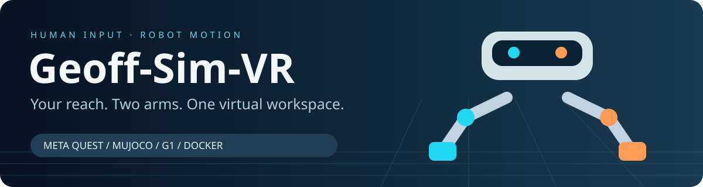
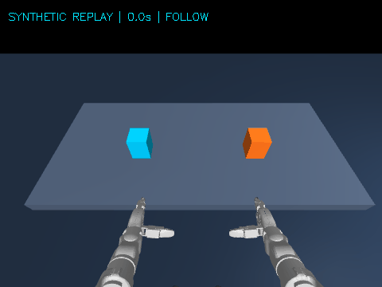
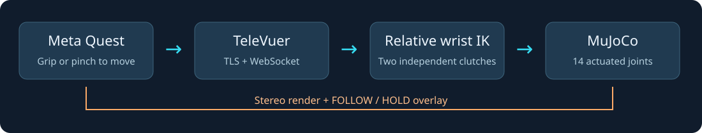

<div align="center">
  
  <p><strong>Meta Quest · Unitree G1 · MuJoCo · Stereo HUD · Docker</strong></p>
  <a href="https://github.com/DavidBatty95/Geoff-Sim-VR/actions/workflows/verification.yml"></a>
  <p><a href="#quick-start">Quick start</a> · <a href="docs/QUEST_SETUP.md">Headset setup</a> · <a href="#recorded-simulation-demo">Demo</a> · <a href="docs/INDEX.md">Docs</a> · <a href="docs/ARCHITECTURE.md">Architecture</a> · <a href="docs/VALIDATION.md">Results</a> · <a href="docs/PROJECT_STATUS.md">Progress</a></p>
</div>

**Put the robot's workspace in your headset.** Geoff-Sim-VR connects a Meta Quest's
tracked controllers or hands to a pair of seven-joint G1 arms in MuJoCo. Hold a
controller grip—or pinch your fingers—to move an arm. Release to hold position.
The headset receives a stereo view of the simulated workspace with a live
**FOLLOW / HOLD** overlay for each arm.

It brings the modified TeleVuer display/tracking package from `geoff_remote_ws`
together with the G1 assets from [GeoffMain](https://github.com/DavidBatty95/GeoffMain),
using a native MuJoCo control backend. It is the immersive arm-teleoperation
companion to [Geoff-Sim](https://github.com/DavidBatty95/Geoff-Sim), using the
**Unitree G1 humanoid**. [Dougie-Sim](https://github.com/DavidBatty95/Dougie-Sim)
is the separate Go2 quadruped exploration project.

Previously named **Dougie-VR**, this repository is now **Geoff-Sim-VR**. The
launcher is still named `dougie-vr` and the Python package is `dougie_vr`; use the
commands below with the new repository URL.

**Current status · 26 October 2026:** Docker build, real physics, offscreen stereo
rendering, and all four live XR protocol profiles pass automated checks.
**A physical Meta Quest session has not yet been tested.** Pairing, certificate
trust, headset rendering and perceived latency remain the final on-device checks.

| Verified capability | Measured scope |
| --- | --- |
| Control and physics tests | **10 passed**, including real IK/physics and vendor hand/controller events |
| Live TLS/WebSocket sessions | **4/4 passed**: hand/controller × immersive/ego |
| Live input and image transport | **150 input messages per profile**, stereo image messages received, both arms moved |
| Tracking-loss behavior | Both arms returned to **HOLD** after disconnect in all four profiles |
| Synthetic eight-second replay | Both wrists moved **14.27 cm**; mean position error **3.42 cm** |
| Live simulation timing | **0.992–0.995 simulation seconds per wall second** in the recorded GPU probes |

[Raw session evidence](docs/results/live-sessions.json) · [Replay metrics](docs/results/verification.json) · [Verification scope](docs/VALIDATION.md)

## Recorded simulation demo



The complete eight-second replay is shown at 5 fps: six seconds of generated wrist
motion followed by two seconds of hold. These are **actual MuJoCo-rendered frames
driven by synthetic poses**, not a recording from a Quest or a physical robot.
The GIF shows the left-eye view; live operation streams separate left/right images.

## Explore Geoff-Sim-VR

| Capability | What you can do |
| --- | --- |
| **Controller input** | Hold each Touch controller's grip to independently control its corresponding arm |
| **Hand input** | Pinch thumb/index to engage the tracked wrist; release to reposition yourself |
| **Relative calibration** | Every new grip/pinch anchors the current tracked pose to the measured robot wrist |
| **Immersive viewing** | A large stereo camera display of the virtual workbench |
| **Ego/HUD viewing** | A smaller stereo panel; use the browser's pass-through/AR entry where supported |
| **Desktop monitor** | Read-only stereo preview, tracking counters, wrist positions and runtime health |
| **Headless verification** | CPU-only Docker tests and reproducible replay, with no headset or ROS installation |



## Quick start

Host: **Linux x86-64**, Docker Engine with Compose v2+, Python 3 and OpenSSL.
An NVIDIA GPU plus NVIDIA Container Toolkit is recommended for headset use.
The CPU/OSMesa fallback needs no display server, GPU passthrough, ROS or Conda.
Allow roughly 3 GB for the image/build cache and source checkout.

```bash
git clone git@github.com:DavidBatty95/Geoff-Sim-VR.git
cd Geoff-Sim-VR
./dougie-vr build
./dougie-vr test

# Use this PC's actual LAN IPv4 address, reachable from the Quest:
./dougie-vr certs 192.168.0.106
./dougie-vr up-gpu
# Without NVIDIA support: ./dougie-vr up
```

Connect the headset and host to the same network. After completing
[certificate trust and browser setup](docs/QUEST_SETUP.md), open in **Quest Browser**:

```text
https://192.168.0.106:8012/?ws=wss://192.168.0.106:8012
```

Replace **both** addresses with your host's address. Enter the browser's VR mode,
put your controllers in a comfortable forward position, and hold the left/right
**grip** to engage that arm. The first pose calibrates without a target jump.
Release before recentering your headset or changing your stance.

On the host, open **http://127.0.0.1:8080** for the live stereo monitor.

```bash
./dougie-vr status
./dougie-vr logs
./dougie-vr down
```

The local development certificate is not automatically trusted by a Quest.
If the browser refuses immersive mode, finish the HTTPS steps in the setup guide
before troubleshooting pose delivery.

### Hand tracking and HUD mode

```bash
# Enable Quest hand tracking and put the controllers down:
INPUT_MODE=hand ./dougie-vr up-gpu

# Smaller camera panel; choose pass-through/AR in the browser where available:
INPUT_MODE=hand DISPLAY_MODE=ego ./dougie-vr up-gpu

# Restore the default controller / immersive profile:
INPUT_MODE=controller DISPLAY_MODE=immersive ./dougie-vr up-gpu
```

Pinch **thumb and index finger** to follow in hand mode. Each hand is independent.
Arm targets stop updating after **250 ms** without a valid pose. Re-engaging
recalibrates the relative mapping at the robot's current measured wrist pose.

### Run a demo without a headset

```bash
./dougie-vr demo
# results/synthetic-replay.gif, results/preview.png, results/verification.json
```

To verify the live server rather than just the controller library:

```bash
# Creates/restarts only this project's containers; run without an active headset.
python3 scripts/verify_sessions.py --gpu
# Omit --gpu to exercise the CPU fallback. Results: results/live-sessions.json
```

## What is simulated

This is a **fixed-base arm teleoperation rig**. The G1's original arm geometry,
joint limits and inertial properties drive 14 position actuators under MuJoCo
gravity with bias-force compensation. The legs, waist and fingers are fixed.
Robot collisions are disabled in this commissioning scene; the colored blocks
are visual targets. The cameras are a fixed, downward-looking stereo pair, not
head-orientation-steered cameras.

Walking, physical grasping, BrainCo finger retargeting, physical-robot DDS output,
and full-body balance are outside this implementation. The original hardware
controller is not started by this container. See [architecture](docs/ARCHITECTURE.md)
and [progress](docs/PROJECT_STATUS.md) for the integration boundary.

## Repository map

```text
Geoff-Sim-VR/
├── dougie-vr                 Daily build/run/test launcher
├── Dockerfile                Headless Python + MuJoCo + TeleVuer runtime
├── compose*.yaml             CPU baseline and NVIDIA/EGL override
├── dougie_vr/                Physics, IK, clutches, rendering, server and replay
├── assets/g1/                Original GeoffMain MJCF, meshes and license
├── vendor/televuer/          Existing local TeleVuer fork plus queue fix
├── scripts/                 Live profile verification and evidence publication
├── tests/                   Behavioral tests against the real MuJoCo model
└── docs/                    Setup, architecture, measured results and media
```

## Documentation

| Guide | Contents |
| --- | --- |
| [Documentation index](docs/INDEX.md) | Choose a task and its entry point |
| [Quest setup](docs/QUEST_SETUP.md) | Networking, certificates, controls and troubleshooting |
| [Architecture](docs/ARCHITECTURE.md) | Processes, coordinate frames, physics and integration decisions |
| [Validation](docs/VALIDATION.md) | Reproduction commands, measured outcomes and hardware checks |
| [Project status](docs/PROJECT_STATUS.md) | Implemented scope and next integration steps |
| [Source provenance](docs/SOURCES.md) | GeoffMain, local TeleVuer modifications, licensing and hashes |

## Credits

- **Unitree Robotics:** G1 model/assets, XR conventions and TeleVuer.
- **Vuer:** WebXR scene, tracking and image transport.
- **MuJoCo:** native rigid-body simulation, kinematics and rendering.
- **GeoffMain / geoff_remote_ws:** the source workspace and modified headset display package.

Original project code is MIT licensed. Vendored components retain their own
licenses: [TeleVuer](vendor/televuer/LICENSE), [G1 assets](assets/g1/LICENSE).
